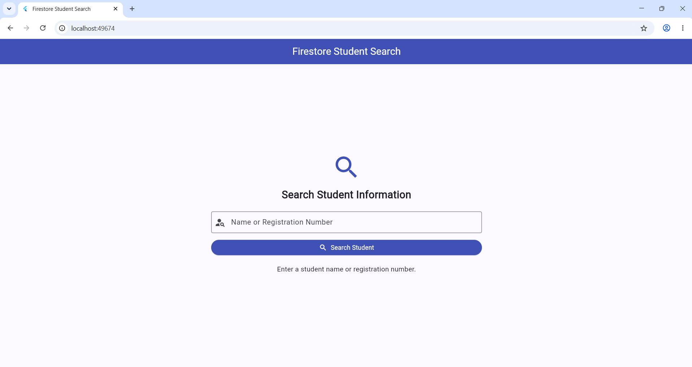
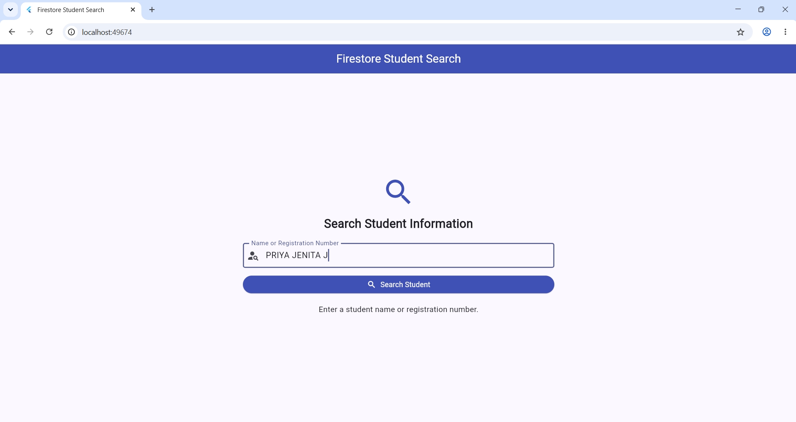
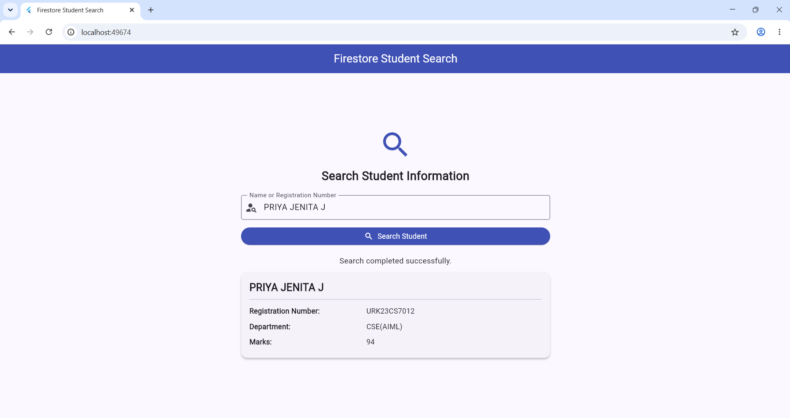

# Experiment 8 – Searching Information in Google Firestore Database

## Aim
To develop a Flutter application that retrieves information from Google Cloud Firestore based on user search input and displays the relevant information on the screen.

## Description
This experiment demonstrates how to search and retrieve student information from Google Cloud Firestore using Flutter. The application allows users to enter a student's name or registration number and search for the corresponding record in the Firestore database.

The application retrieves matching records from the `students` collection and displays the student's name, registration number, department, and marks. It also displays an appropriate message when no matching record is found.

## Technologies Used
- Flutter
- Dart
- Firebase Core
- Google Cloud Firestore
- Visual Studio Code
- Chrome

## Features
- Search student records using a name.
- Search student records using a registration number.
- Retrieve information from Google Cloud Firestore.
- Display matching student details on the screen.
- Show a loading indicator while searching.
- Display a message when no matching record is found.
- Handle Firestore query errors.

## Database Structure

**Collection Name:** `students`

**Fields:**
- `name` – Student name
- `registrationNumber` – Student registration number
- `department` – Student department
- `marks` – Student marks
- `createdAt` – Record creation timestamp, if available

## Working Procedure
1. Create a Flutter application.
2. Configure Firebase using the Firebase Console and FlutterFire CLI.
3. Enable Google Cloud Firestore in the Firebase project.
4. Add the `firebase_core` and `cloud_firestore` dependencies.
5. Initialize Firebase in the Flutter application.
6. Design a search interface with a text field and search button.
7. Accept the student name or registration number as input.
8. Search the `students` collection using Firestore queries.
9. Retrieve and display the matching student information.
10. Display an appropriate message if no matching record is found.

## Sample Input

| Field | Value |
|---|---|
| Search By | Registration Number |
| Search Value | REG2026CS01 |

## Expected Output

The application displays the matching student information retrieved from Firestore.

Example:

- Name: maanjadhav
- Registration Number: REG2026CS01
- Department: CSE(AIML)
- Marks: 94

If no matching record exists, the application displays:

`No matching student found.`

## Output Screenshots

### 1. Initial Application Screen

### 2. Search Input

### 3. Search Result

## Result
Thus, a Flutter application was developed successfully to search and retrieve student information from Google Cloud Firestore based on user input and display the relevant information on the screen.
